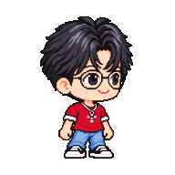
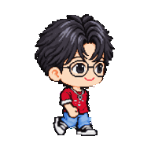
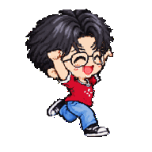
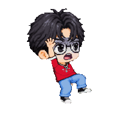
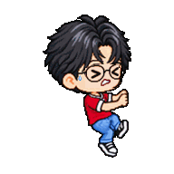
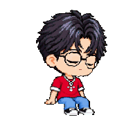

<h1 align="center">봉봉이 · Bongbong</h1>

<p align="center">
  <strong>창 위를 산책하고, 가끔 꾸벅꾸벅 졸기도 하는 작은 바탕화면 친구</strong>
</p>

<p align="center">
  
</p>

<p align="center">
  Windows 데스크톱 캐릭터 · Godot 4.7 · 개발 중
</p>

---

봉봉이는 컴퓨터를 사용하는 동안 바탕화면에서 함께 지내는 SD 캐릭터입니다.
혼자 걷고 뛰다가 창을 타고 올라가고, 창 위에 앉아 쉬기도 합니다.
클릭하면 반갑게 인사하고, 마우스로 잡으면 놓아 달라는 듯 아둥바둥합니다.

작은 몸짓만 봐도 기분이 전해지는 캐릭터를 목표로 만들고 있습니다.
짧은 팔다리, 통통 튀는 걸음, 장난스러운 표정부터 손목의 연결과 발 디딤까지 하나씩 다듬고 있습니다.

## 봉봉이와 할 수 있는 일

| 기능 | 이런 모습을 보여드립니다 |
|---|---|
| **스스로 산책하기** | 걷기, 가벼운 달리기, 양팔을 들고 통통 뛰기를 골라 이동하고 잠깐씩 쉬어 갑니다. |
| **인사 나누기** | 봉봉이를 클릭하면 얼굴을 돌리며 웃고, 한 손을 흔들어 인사합니다. |
| **잡았다 놓기** | 잡고 있는 동안 팔다리를 아둥바둥 움직입니다. 놓으면 점점 빨라지며 떨어지고, 낙하 상황에 따라 가볍게 착지하거나 엉덩방아를 찧습니다. |
| **창을 놀이터로 쓰기** | 실제 창의 윗면에 서거나 옆면을 붙잡고 올라갑니다. 조금 높은 곳은 점프하고, 더 높은 곳은 그래플링 훅으로 접근합니다. 내려올 때는 벽을 따라 슬라이딩합니다. |
| **창 위에서 쉬기** | 낮게 뛰어올라 털썩 앉습니다. 한동안 키보드·마우스 입력이 없으면 고개를 꾸벅이며 졸고, 옆에 Zzz가 나타납니다. 입력이 돌아오면 잠에서 깹니다. |
| **함께 컴퓨터 하기** | 우클릭 메뉴에서 컴퓨터 모드를 켜면 파란 소용돌이 포털에서 책상과 컴퓨터가 나옵니다. 키보드를 누르면 봉봉이도 양팔로 신나게 타자를 칩니다. |

서 있는 창을 움직이면 봉봉이도 따라 움직이고, 발밑의 창이 사라지면 떨어집니다.
캐릭터 주변을 제외한 투명 영역은 클릭을 통과시켜 아래의 앱을 조작할 수 있도록 했습니다.

## 움직이는 봉봉이

현재 작업에 사용하는 스프라이트 모션 미리보기입니다. 창을 따라 움직이는 위치, 그래플링 줄 등은 실제 실행에서 함께 표시됩니다.

| 걷기 | 통통 뛰기 | 잡혔을 때 |
|:---:|:---:|:---:|
|  |  |  |

| 벽 오르기 | 그래플링 동작 | 꾸벅꾸벅 졸기 |
|:---:|:---:|:---:|
|  |  |  |

## 지금 다듬고 있는 부분

현재는 **새 SD 디자인을 동작별로 교체하는 작업**을 진행하고 있습니다.
머리는 조금 더 크게, 팔다리는 짧게 유지하고, 작은 크기에서도 표정이 잘 읽히도록 맞추고 있습니다.

| 작업 | 진행 상황 |
|---|---|
| 새 기본 대기 자세 | Godot 적용과 확인을 마쳤습니다. 자연스러운 숨쉬기와 독립적인 랜덤 눈 깜빡임을 사용합니다. |
| 새 주머니 자세 | 대표 PNG와 숨쉬기 GIF를 확정했습니다. 손을 넣고 빼는 왕복 연결 GIF는 검토 단계입니다. |
| 나머지 동작 | 팔짱, 걷기, 두 가지 뛰기부터 차례로 새 디자인에 맞출 예정입니다. |

각 동작은 **대표 PNG → 움직이는 GIF → 앞뒤 연결 → Godot 적용** 순서로 확인합니다.
기존 동작과 새 디자인이 함께 있는 단계이며, 위 갤러리에도 교체 전 디자인이 포함되어 있습니다.

## 실행해 보기

현재는 개발 중인 프로젝트이며, 아래 방법으로 소스에서 실행할 수 있습니다.
개발·확인 환경은 **Windows와 Godot 4.7.2**입니다.

### Godot에서 동작을 직접 확인하기

1. 저장소를 내려받습니다.
2. Godot 프로젝트 관리자에서 이 폴더의 `project.godot`을 가져옵니다.
3. 에셋 가져오기가 끝나면 **F5**로 실행합니다.

편집기에서 실행하면 배경이 있는 **수동 모션 테스트 화면**이 열립니다.
처음에는 랜덤 이동이 꺼져 있어 원하는 자세와 동작을 따로 살펴볼 수 있습니다.

| 조작 | 동작 |
|---|---|
| `1` / `2` / `3` | 기본 대기 / 주머니 / 팔짱 |
| `←` / `→` | 걷기 |
| `Shift` + `←` / `→` | 가벼운 달리기 |
| `4` / `5` / `6` | 걷기 / 가벼운 달리기 / 통통 뛰기 반복 |
| `Space` | 이동 정지 |
| `R` | 랜덤 이동 켜기·끄기 |
| 클릭 | 인사 |
| 드래그 후 놓기 | 잡기 → 낙하 → 착지 |
| 우클릭 | 컴퓨터 모드 켜기·끄기 |
| `F1` | 안내 표시 전환 |
| `F8` | 편집기에서 실행 중지 |

### 바탕화면에 띄우기

프로젝트 폴더에서 Godot를 편집기 밖의 별도 실행으로 시작하면 투명한 바탕화면 모드가 열립니다.
아래 PowerShell 예시의 실행 파일 경로는 설치된 Godot 경로로 바꿔 주세요.

```powershell
& "C:\Godot\Godot_v4.7.2-stable_win64.exe" --path .
```

- 화면 오른쪽 아래, 작업표시줄 바로 위에서 시작합니다.
- 잠시 뒤 자동으로 걷거나 뛰기 시작합니다.
- 봉봉이에 키보드 포커스가 있을 때 `Space`로 멈추고, `R`로 랜덤 이동을 다시 켤 수 있습니다.
- 창 위에 서 있을 때 `D`를 누르면 가까운 모서리로 이동해 내려옵니다.
- 일반 상태에서 `Esc`로 종료합니다. 컴퓨터 모드에서는 먼저 우클릭 메뉴로 해당 모드를 꺼 주세요.

실제 Windows 창 위에 서거나 벽을 타는 기능은 이 바탕화면 실행에서 확인합니다.
최소화되거나 다른 창에 가려진 부분은 발판으로 사용하지 않으며, 캐릭터가 들어갈 여유 공간이 필요합니다.

창 인식에는 저장소에 포함된 `native/windows/bin/Bongbong.WindowBounds.exe`를 사용합니다.
직접 다시 빌드하려면 프로젝트 폴더에서 아래 명령을 실행해 주세요.

```powershell
& .\native\windows\build.ps1
```

자세한 실행·조작 방법은 [데스크톱 실행 안내](DESKTOP_WINDOW_TEST.md), 보조 프로그램 설명은 [Windows 창 인식 문서](native/windows/README.md)에 정리되어 있습니다.

## 어떻게 만들고 있나요?

| 도구 | 역할 |
|---|---|
| **Godot · GDScript** | 캐릭터의 상태 전환, 이동·낙하, 입력 반응, 투명 창 표시를 구현합니다. |
| **C# · Windows API** | 실제 창의 위치와 입력 활동 정보를 Godot에 전달합니다. |
| **sprite-gen · Grok** | 기준 이미지를 바탕으로 모션 영상을 만들고, 배경을 제거해 스프라이트를 추출합니다. |
| **Aseprite** | 프레임별 도트, 표정, 피부·옷 색상, 손과 발의 연결을 다듬습니다. |
| **RIFE** | 필요한 모션에서 중간 프레임을 보간해 움직임을 정리합니다. |

생성한 모션은 바로 적용하기보다 비율, 외곽선, 반복 구간, 발 위치를 확인하며 수정합니다.
봉봉이를 실행할 때는 저장된 스프라이트를 사용하며, Grok 로그인이나 영상 생성은 제작 과정에서 사용합니다.

<details>
<summary>컴퓨터 모드에서 사용하는 입력 정보</summary>

컴퓨터 모드는 입력 활동에 맞춰 타자 동작을 재생합니다.
현재 Windows 보조 프로그램은 컴퓨터 모드가 켜져 있을 때 입력 횟수와 눌림 여부를 전달하며, 입력한 문자나 문서 내용은 전달하거나 저장하지 않습니다.
졸기 동작에는 마지막 키보드·마우스 입력 이후의 경과 시간을 사용합니다.

</details>

<details>
<summary>프로젝트 구조와 개발 문서</summary>

```text
assets/character/   캐릭터 스프라이트와 최종 Aseprite 편집 원본
scenes/            메인 씬과 동작별 애니메이션 리소스
scripts/           이동·상호작용·창 탐색·애니메이션 제어
native/windows/    Windows 창·입력 활동 정보 연결
tests/             동작 전환과 창 상호작용 검사
project.godot      Godot 프로젝트 설정
```

- [대기 동작 확인](IDLE_TEST.md)
- [걷기 확인](WALK_TEST.md)
- [달리기 확인](RUN_TEST.md)
- [창 오르기 구현 기록](WINDOW_CLIMB_PLAN.md)
- [데스크톱 실행·검수 기록](DESKTOP_WINDOW_TEST.md)

일부 문서에는 이전 단계의 검수 기록도 함께 남아 있습니다.
제작 중간 영상·후보·비교 자료는 별도로 관리하고, 실행에 필요한 결과물과 최종 편집 원본을 중심으로 보관합니다.

</details>

---

봉봉이의 작은 움직임을 하나씩 완성해 가고 있습니다.
어색한 동작이나 함께 보고 싶은 모습이 있다면 편하게 의견을 남겨 주세요.
